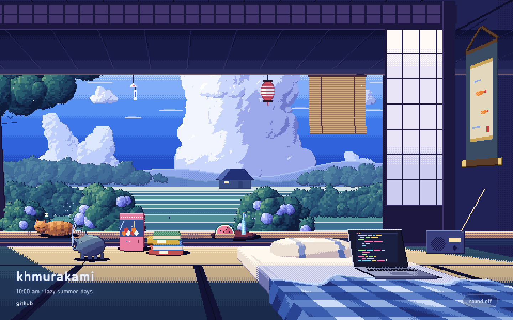
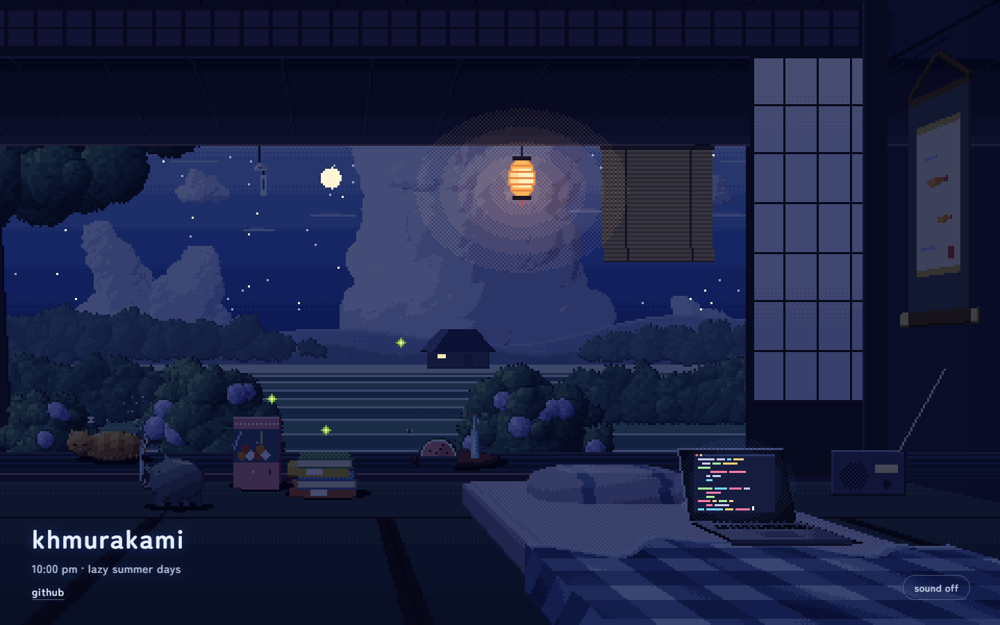
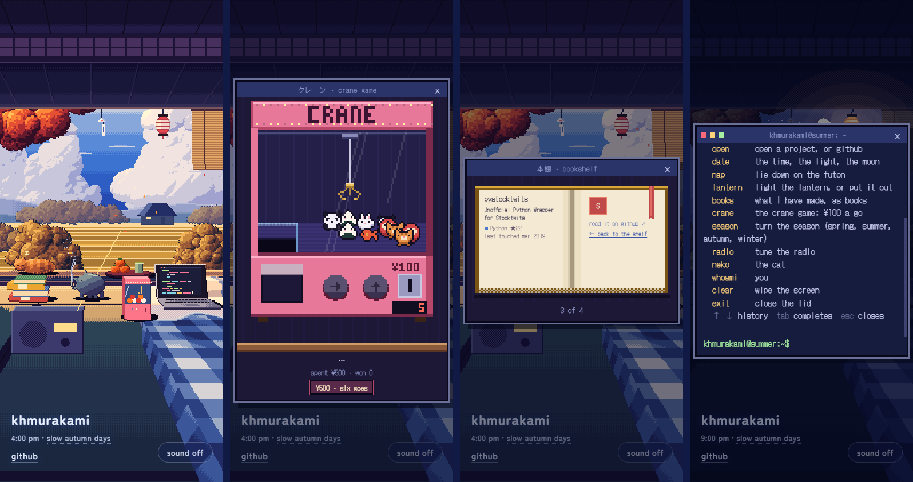
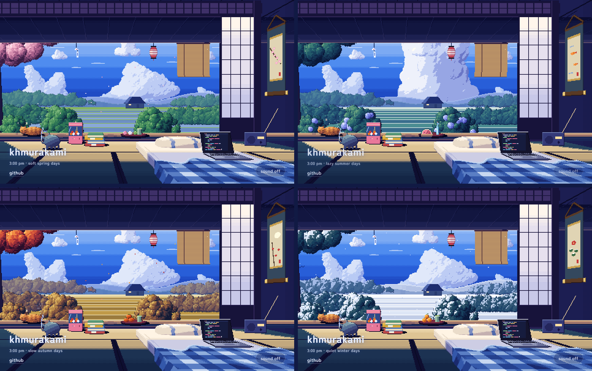

# khmurakami.github.io

A pixel-art tatami room you can sit in: a Japanese room with the door open
onto rice paddies, drawn on a canvas at a pixel artist's resolution and kept
on real time. Morning light moves across the mats, evening turns to night with
a moon, and the season changes with the calendar. The room is the homepage;
the things in it are the navigation.

**[khmurakami.github.io](https://khmurakami.github.io)**



Plain HTML, CSS and JavaScript: no framework, no build step, no bundler.
GitHub Pages serves `main` directly, so **a push to `main` is a deploy**.

## What's in the room

Tap (or click) things:

| Thing | What it does |
|---|---|
| the books | a shelf of my projects, from GitHub; pick one and it opens to its page |
| the laptop | a little terminal (`help` lists the commands) |
| the crane machine | a ¥100 crane game; what you win sits on its roof |
| the cat | wake her up for a stretch and a purr |
| the radio | lo-fi, a baseball game, a festival, off |
| the hanging scroll | turn the season (on a phone, tap the season under my name) |
| the lantern, the chime, the blind, the futon | light, ring, roll up, nap |
| the paddies | rings on the water |

A quick swipe sends a gust through the room. At night a finger held still (or
the mouse) carries a little light, and the cat's eyes catch it. With a mouse
the room shifts as you look around; on a phone it stays still under your
finger, and tilting the phone shifts it a little where the phone allows.



On a phone, with the crane game, the bookshelf and the terminal:



The season follows the calendar:



Terminal commands: `help`, `ls`, `cat`, `projects`, `open`, `books`, `crane`,
`date`, `nap`, `lantern`, `season`, `radio`, `neko`, `whoami`, `clear`, `exit`.

## Running it

```bash
npm run serve                   # http://127.0.0.1:4173, nothing cached
npm test                        # unit tests: Python analysis + node --test
```

Useful page options:

| Option | Effect |
|---|---|
| `?hour=21` | pin the room's clock to an hour (0 to 23.99) |
| `?date=2026-07-05` | pin the date, which picks the season and the moon |
| `?gh=off` | don't ask GitHub for the project list; use the built-in one |
| `?still` | draw one frame and stop |
| `?look=x,y` | where you're looking from, -1 to 1 |
| `?scene=tatami` | an earlier painted version of the room (`tatami`, `futon`); the default is `tatami-pixel` |

## How it's put together

The long version, with the pixel rules, the camera, time, touch and sound, is
in [docs/how-it-works.md](docs/how-it-works.md).

- `js/stage.js` runs a scene: the canvas, the frame loop, sound, the clock.
- `js/scenes/tatami-pixel.js` is the room. Every object is its own sprite
  (`js/pixel.js`) with its own colour ramp and light from the window, outlined
  and dithered by hand rules, and drawn at a whole-number scale. The things you
  can touch, their labels and what they do are declared in one place there.
- `js/roomtime.js` keeps the room's time: sun, moon, season.
- `js/stack.js` and `js/sky.js` paint the clouds and plants; `js/layers.js`
  composes painted layers.
- `js/soundscape.js` is the sound, all synthesized with Web Audio.
- `js/terminal.js`, `js/shelf.js` and `js/crane.js` are the laptop's terminal,
  the bookshelf and the crane game, each drawn in pixels with real buttons
  over the drawn ones.

Script addresses in `index.html` carry a version (`?v=…`) so phones fetch new
code right after a deploy; change it when you push script changes.

## The studio

`studio/` is where the art is made and judged: study pages that paint one
thing at a time, and tools that measure renders against references. See
[`studio/README.md`](studio/README.md). Reference images are other people's
work and are never committed.

`scripts/check-things.mjs` takes pictures of the room in headless Chrome
(`--look=out.png`, `--film=…`, `--map` for where a finger would land) for
judging by eye.

## Resources

What the site uses, all of it free:

- **Fonts:** [Zen Maru Gothic](https://fonts.google.com/specimen/Zen+Maru+Gothic)
  for the words and [DotGothic16](https://fonts.google.com/specimen/DotGothic16)
  for the pixel windows, both from Google Fonts under the SIL Open Font License.
- **Data:** the [GitHub REST API](https://docs.github.com/en/rest) for the list
  of projects, cached for the visit, with a built-in fallback.
- **Browser features:** Canvas 2D for all the drawing,
  [Web Audio](https://developer.mozilla.org/docs/Web/API/Web_Audio_API) for all
  the sound, pointer events for touch and mouse, and device orientation for
  tilt.
- **Studio tools:** Python with [NumPy](https://numpy.org) and
  [Pillow](https://python-pillow.org) for measuring renders; headless
  Chrome for taking pictures.
- **Hosting:** [GitHub Pages](https://pages.github.com), straight from `main`.

No images, sounds or code from anywhere else are in the room: every pixel and
every sound is made by the code in `js/`. The reference pictures used while
learning to paint clouds are other people's work and stay out of the
repository.

## License

See [LICENSE](LICENSE).
